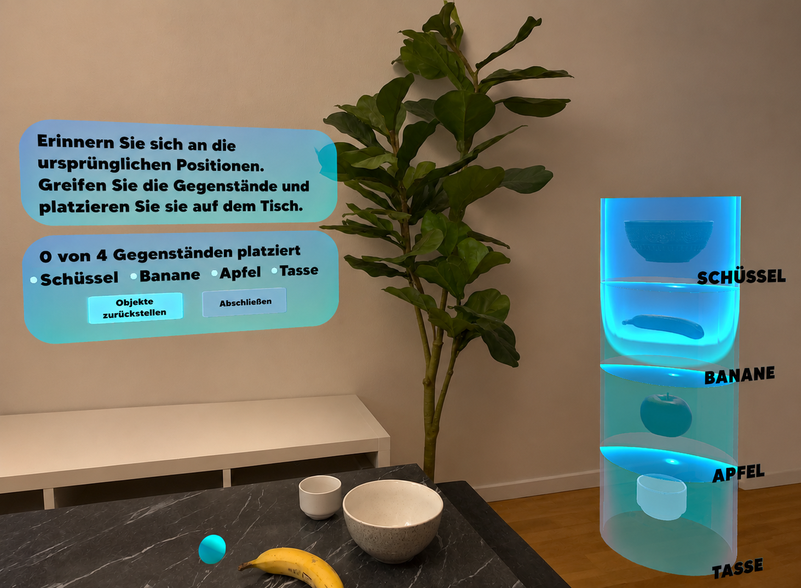

# ENGRAM – Digital Twins for Spatial Memory Assessment in Augmented Reality



**ENGRAM** is a Unity-based augmented reality prototype for spatial memory tasks using familiar everyday objects. On a Meta Quest 3, it identifies physical objects, associates them with prepared 3D models, records their positions, and turns the arrangement into an interactive memory task.
It is designed to assess spatial memory through an interactive augmented reality task, with a focus on potential applications for people with mild cognitive impairment (MCI) or early-stage Alzheimer's disease. **Engram is a research and educational prototype, not a clinically validated assessment or diagnostic tool.**

**Language:** The application's on-screen interface and recorded voice instructions are in German.

## What Engram does

- **Recognizes everyday objects:** YOLO11s runs on-device through the Unity Inference Engine using the Quest's Passthrough Camera API.
- **Creates an AR representation:** Recognized object classes are matched to a library of textured, scale-adjusted 3D models.
- **Records spatial context:** Object positions are stored relative to a persistent table reference using a spatial anchor.
- **Tests spatial recall:** Four digital objects move into a four-slot inventory; the user places them back at their remembered locations.
- **Supports two interaction methods:** Touch controllers and hand-tracked pinch gestures.
- **Provides guided interaction:** Accessible on-screen instructions, recorded voice prompts, sound effects, haptic feedback, and audio muting.
- **Records results:** Horizontal placement deviations, object-specific tolerance zones, completion time, corrections, and task results are saved in JSON format.

### Supported object classes

`apple` · `banana` · `book` · `bottle` · `bowl` · `cell phone` · `clock` · `cup` · `scissors` · `wine glass`

> **About the digital twins:** The current 3D models were created in advance from photographs of the specific test objects using Meshy, then prepared for Unity. Engram performs **object recognition and model matching at runtime**, not automatic 3D generation of arbitrary household objects. A different home environment may require additional models or a future model-generation workflow.

## How to use Engram

1. **Start the application on a Meta Quest 3.** Allow the requested camera and spatial permissions. Follow the in-headset instructions; introductory instructions can be skipped where offered.
2. **Establish the table reference.** Select the tabletop and confirm its position. Engram saves a spatial anchor so the reference can be restored in later sessions.
3. **Arrange and capture the objects.** Place recognizable objects on the table, allow the detector to identify them, and save their positions. A task uses four objects from the registered arrangement.
4. **Memorize the arrangement.** Engram displays the associated 3D models in the recorded locations before transferring the four task objects to the inventory.
5. **Recall the positions.** Pick up the virtual objects using a controller or a pinch gesture, then place them where you remember the originals. Placement can be corrected before completing the task.
6. **Review the results.** Engram evaluates placements against object-specific reference zones, displays the result, and saves the session data. A new task can then be started.

The application is designed for seated use. The interface uses large text and provides optional spoken instructions. Its accessibility for the intended clinical population has **not** yet been formally validated.

## Technology

| Component | Implementation |
| --- | --- |
| Development | Unity 6, C#, Universal Render Pipeline (URP) |
| Target device | Meta Quest 3 (standalone) |
| Mixed reality | Meta XR SDK and Passthrough Camera API |
| Object detection | YOLO11s, Unity Inference Engine (GPU backend) |
| Spatial registration | Table reference, spatial anchors, camera-based object localization |
| 3D content | Pre-generated Meshy assets, prepared and textured for Unity |
| Interaction | Meta controller input and hand tracking |
| Results | Table-relative coordinates, zone-based scoring, local JSON files |

### Source code layout

Core scripts are organized under `Assets/_Scripts/`:

| Directory | Responsibilities |
| --- | --- |
| `Camera/` | Camera feed preview |
| `Detection/` | YOLO11s object detection and 2D detection overlay |
| `Spatial/` | Table anchors, object position registration, 3D visualization, and inventory |
| `Memory/` | Recall task, interaction state, zone evaluation, and session flow |
| `UI/` | Guided interface, voice/audio feedback, and UI interaction |

The project also contains development and diagnostic scripts used to test tracking and spatial registration.

## Opening and building the Unity project

### Requirements

- **Unity 6**, using the editor version specified in `ProjectSettings/ProjectVersion.txt` (or a compatible version), with **Android Build Support** installed.
- **Meta Quest 3** with developer mode enabled and a compatible version of **Meta Horizon OS** (Passthrough Camera API requires v74 or newer).
- The Meta XR, camera-access, and Unity Inference Engine dependencies configured by the project. Check `Packages/manifest.json` and any imported SDK assets.
- The **YOLO11s ONNX model**, a COCO class-label file in the required model order, and the 3D prefabs. The model weights and licensed Leohpaz audio are intentionally not included in this public source repository; restore both before building (see below).

### Restore the YOLO11s model (not included)

Engram uses the **Ultralytics YOLO11s detection model** in **ONNX** format. The detector expects a fixed **640 × 640** input, the standard **80 COCO classes**, and raw prediction output (without exported NMS); non-maximum suppression is handled in `EngramObjectDetector.cs`. The pretrained weights are not committed to this repository.

Generate the required ONNX file using [Ultralytics' official YOLO11 model](https://docs.ultralytics.com/models/yolo11/) and [ONNX export documentation](https://docs.ultralytics.com/integrations/onnx/):

```bash
python -m pip install ultralytics onnx
python -c "from ultralytics import YOLO; YOLO('yolo11s.pt').export(format='onnx', imgsz=640, batch=1, dynamic=False, nms=False)"
```

The first export downloads `yolo11s.pt` if it is not already available and creates `yolo11s.onnx`. Then:

1. Place `yolo11s.onnx` inside the Unity project's `Assets/` directory. **If the repository contains a `yolo11s.onnx.meta` file, put the model at its corresponding path and keep that `.meta` file** so existing Unity references can be restored.
2. Allow Unity to import it as a model asset through **Unity Inference Engine**.
3. In the scene, select the object containing `EngramObjectDetector` and assign the imported model to its **Model Asset** field if Unity has not restored the reference automatically.
4. Verify that **Classes Asset** points to the COCO labels file containing **all 80 class names in the model's original order** (not just Engram's ten supported categories). The detector expects an unmodified YOLO11s detection output compatible with its current postprocessing.

> **Licensing:** Ultralytics distributes YOLO11 and its model weights under **AGPL-3.0**, with a separate Enterprise licensing option. Downloading or exporting the weights separately does **not** remove the applicable license obligations for use or distribution of the model and the application. Consult the [Ultralytics license information](https://www.ultralytics.com/license) before redistributing builds or making other licensing decisions.

### Restore Leohpaz audio (not included)

The source sound effects from [Leohpaz – RPG Essentials Sound Effects – FREE!](https://marketplace.unity.com/packages/audio/sound-fx/rpg-essentials-sound-effects-free-227708) are licensed under the **Standard Unity Asset Store EULA** and are therefore **excluded from the public repository**. To rebuild Engram with these effects:

1. Obtain the pack through the official Unity Asset Store using your own account.
2. Import the licensed content into **`Assets/Leohpaz/`**, preserving the original asset locations and Unity metadata where possible.
3. Open the Engram scene and check the audio references in the Inspector. Reassign any references Unity could not restore.

The `.gitignore` excludes **Leohpaz source audio and other package content**, but preserves `.meta` files to help Unity retain asset identifiers when the same pack is imported. The excluded sounds remain present in the author's local project.

### Setup

1. Clone or download this repository.
2. In Unity Hub, choose **Add project from disk** and select the repository folder (the directory containing `Assets/`, `Packages/`, and `ProjectSettings/`).
3. Open the project in the appropriate Unity editor and let Unity finish importing packages and assets.
4. **Restore the YOLO11s model and Leohpaz audio** using the instructions above. Open the Engram scene under `Assets/` and check the detector's model/label references and the audio references.
5. In **Build Profiles**, select **Android**, check the project's Meta XR and passthrough camera settings, and build for the connected Quest 3.
6. Install and launch the build on the headset. Grant the requested headset camera and spatial permissions.

**Important:** Live Passthrough Camera API functionality must be tested on a supported Quest headset; running the Unity editor alone does not reproduce the complete capture-and-registration pipeline. If third-party assets were omitted from the repository, they must be restored from their authorized sources before building.

## Evaluation snapshot

The prototype was tested on a Meta Quest 3:

| Measurement | Result |
| --- | --- |
| Isolated-object detection | 47/50 correct (94%) |
| Correct 3D model assignments | 10/10 |
| Controlled placement within reference zones | 34/40 (85%), before a later apple-tolerance adjustment |
| Recognition pipeline processing time | Mean 299.9 ms across 20 measurements (289–312 ms) |
| Full application runs | 20/20 completed without a crash; one transient inventory interaction issue |

**Performance caveat:** Frame rate varied across OVR Metrics recordings and sometimes fell below the configured 72 Hz display refresh rate. The reported processing time includes image preparation and post-processing; it is not a benchmark of neural-network inference alone. Placement accuracy also depends on spatial registration, interaction precision, and configured tolerance zones. A preliminary user test was encouraging but does not establish clinical suitability.

## Data and privacy

Engram stores task results and registered object positions as JSON under Unity's `Application.persistentDataPath` on the headset. Spatial anchors are managed through the Quest platform. Recorded locations and test results may reveal information about a physical environment, so do not publish real user data, passthrough captures, or device-specific exports without appropriate review and consent.

Generated builds, logs, recorded metrics, local test-result exports, YOLO11s model weights, and Leohpaz source assets are intentionally excluded by `.gitignore`.

## Current limitations and next steps

- The object library is limited to ten supported categories and a prepared set of digital twins.
- Object orientation is not automatically reconstructed; elongated or asymmetric objects may have visible rotational differences.
- Spatial registration is approximate. Object-dependent tolerance zones reduce false scoring caused by registration uncertainty, but also reduce sensitivity to small placement errors.
- Hand tracking supports the recall task, although fine placement can be less precise than with controllers.
- Performance optimization and broader accessibility testing are still needed.
- Longitudinal studies, testing with the intended population, and clinical validation would be necessary before any use for assessment in healthcare settings. **The app cannot diagnose MCI, Alzheimer's disease, or other medical conditions.**

A future version could support user-specific 3D model generation, a larger object vocabulary, more robust pose estimation, and longitudinal result comparison.

## Third-party assets, audio and credits

The project includes 3D content, spoken instructions, and sound effects originating from the following sources:

| Source | Use in Engram | Licensing / attribution |
| --- | --- | --- |
| [Dustyroom – FREE Casual Game SFX Pack](https://marketplace.unity.com/packages/audio/sound-fx/free-casual-game-sfx-pack-54116) | UI and interaction sound effects | The sound samples are released under **Creative Commons Zero (CC0)**, as stated in the license included with the pack. Attribution is optional; credit is provided here. |
| [Leohpaz – RPG Essentials Sound Effects – FREE!](https://marketplace.unity.com/packages/audio/sound-fx/rpg-essentials-sound-effects-free-227708) | Additional interaction sound effects | **Standard Unity Asset Store EULA** (listed as an Extension Asset). The source assets are omitted from GitHub (`Assets/Leohpaz/`) and must be imported separately by users who have obtained the pack. |
| [Meshy](https://www.meshy.ai/) | Creation of object-specific 3D models from photographs | Models were generated under a paid plan and prepared for use in Unity. Rights to the generated outputs remain subject to Meshy's terms and the rights in any source images. |
| [ElevenLabs Text to Speech](https://elevenlabs.io/text-to-speech) | Pre-recorded spoken instructions | Audio was generated using a paid subscription, subject to ElevenLabs' terms and rights in the inputs and voices used. |

The source 3D models are **prepared assets**, not models generated by Engram at runtime. The use of Meshy and ElevenLabs in the development workflow does not mean that their generation services, models, or APIs are embedded in this project.

**For anyone rebuilding the project:** Follow the model-export and audio-restoration instructions above. The Unity Asset Store EULA generally permits licensed assets *embedded in a finished application*, but not unrestricted redistribution of the original asset files in a public source repository. Attribution alone does not change this restriction.

The project also depends on third-party software and SDKs, including [Unity](https://unity.com/), [Meta XR](https://developers.meta.com/horizon/), and [Ultralytics YOLO11](https://github.com/ultralytics/ultralytics). The model is a separately sourced AGPL-3.0-licensed dependency; excluding model weights from this repository does not itself resolve the license requirements that may apply to redistributing Engram or a compiled build. SDK and asset licenses also remain applicable.

No repository-wide open-source license has been specified. A future `LICENSE` file should distinguish the original project code from third-party assets and dependencies; a license for Engram's code would not automatically relicense those assets.
